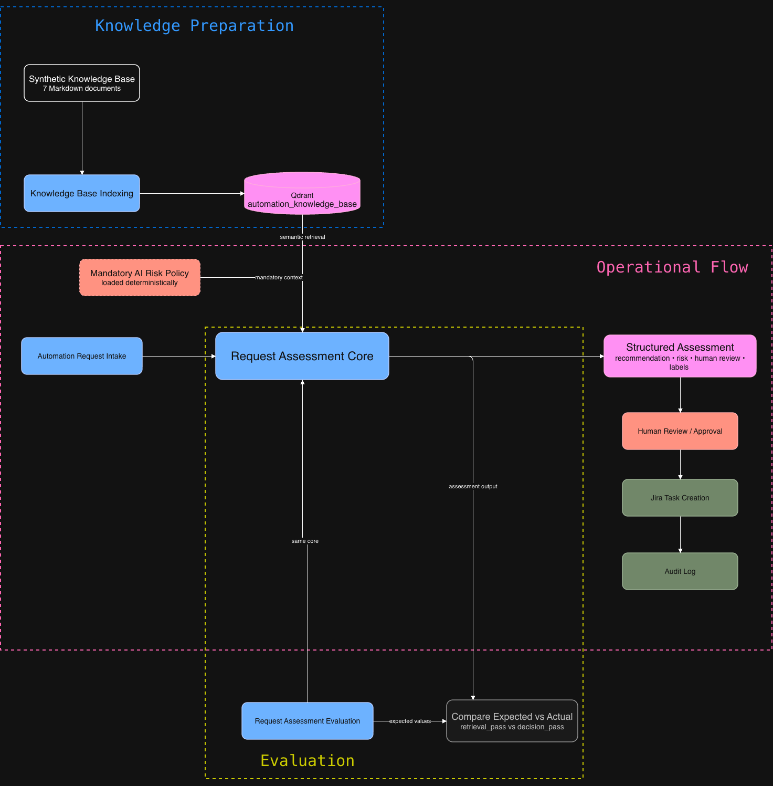
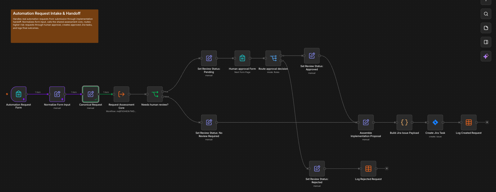
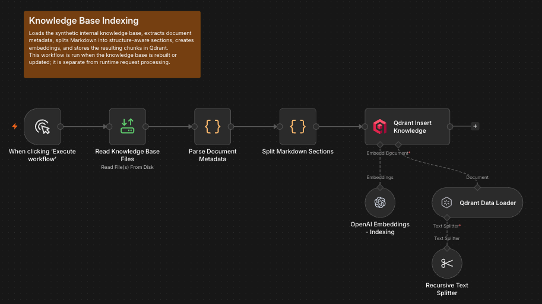
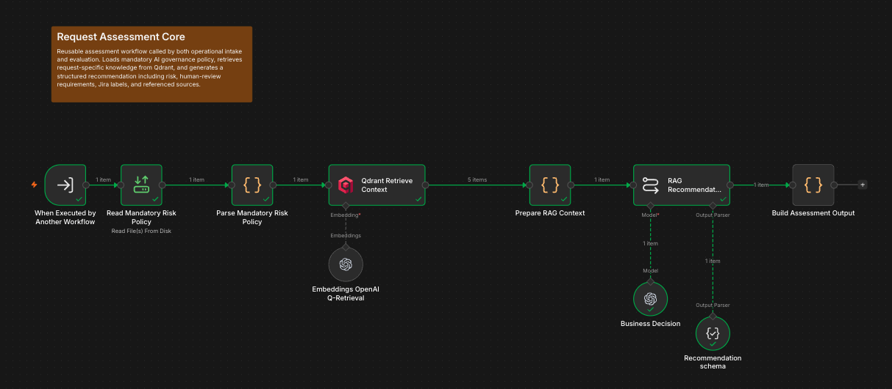
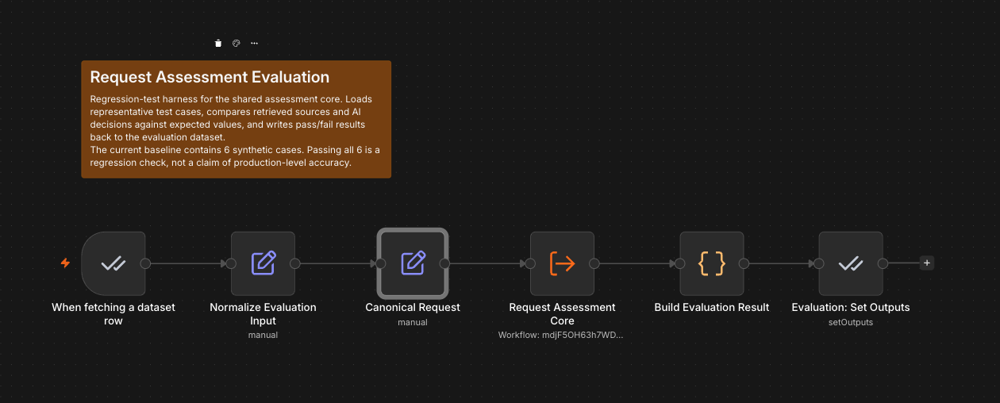

# AI Process & Knowledge Assistant

An n8n portfolio project exploring AI-assisted automation request assessment, RAG-based knowledge retrieval, human-in-the-loop routing, Jira handoff, and regression evaluation.

The system takes an automation request, retrieves relevant internal knowledge from Qdrant, generates a structured assessment, routes ambiguous or higher-risk requests to human review, and creates Jira tasks for approved requests. Final outcomes are logged for traceability.

---

## Why I Built This

I wanted to move beyond basic n8n workflows and build something closer to an end-to-end operational process.

Because I had previously worked with Jira and project coordination, I was interested in connecting AI decisions to an actual implementation handoff rather than stopping at a generated recommendation.

The project became a way for me to learn and combine:

- workflow routing
- structured LLM outputs
- RAG and vector retrieval
- Qdrant
- human approval flows
- Jira integration
- audit logging
- Docker-based self-hosting
- regression evaluation

---

## Architecture



The project is split into four workflows:

| Workflow | Purpose |
|---|---|
| **Knowledge Base Indexing** | Parses the synthetic knowledge base, creates embeddings, and stores document chunks in Qdrant |
| **Request Assessment Core** | Retrieves relevant context and produces a structured risk and automation assessment |
| **Automation Request Intake** | Handles submission, routing, human review, Jira creation, and audit logging |
| **Request Assessment Evaluation** | Runs regression cases against the same assessment logic used by the operational workflow |

---

## How It Works

```text
Automation Request
        ↓
Normalize Input
        ↓
Request Assessment Core
        ↓
Qdrant Retrieval + Mandatory Risk Policy
        ↓
Structured Assessment
        ↓
Needs Human Review?
       / \
     Yes  No
      ↓    ↓
 Human     Continue
 Review
      ↓
 Approval / Rejection
      ↓
 Jira Task
      ↓
 Audit Log
```

The workflow does **not** automatically implement the submitted business automation.

Its scope is to assess the request, route it appropriately, and create an implementation handoff when the request is approved.

---

## RAG and Knowledge Retrieval

The knowledge base consists of synthetic internal Markdown documents covering topics such as:

- automation guidelines
- AI risk and review policy
- approved tools
- customer support processes
- finance processes
- Jira governance
- previous automation examples

Documents are split by Markdown structure and then recursively chunked before embedding.

Qdrant is used as the persistent vector database for semantic retrieval.

The request title, description, and department are used to retrieve relevant context.

### Mandatory Policy Context

One design change came directly from evaluation.

Initially, the AI risk policy depended on semantic retrieval like the rest of the knowledge base. This caused a case where the model made the wrong risk decision because the mandatory policy was not retrieved.

The final design separates:

```text
Dynamic context → retrieved from Qdrant
Mandatory governance rules → always loaded
```

This makes sure required risk and review rules are always available to the model.

---

## Structured Assessment

The assessment is returned as structured JSON rather than free-form text.

Example fields include:

```json
{
  "recommendation": "...",
  "implementation_approach": "...",
  "risk_level": "Medium",
  "needs_human_review": true,
  "human_review_reason": "...",
  "jira_labels": [],
  "referenced_documents": []
}
```

This makes downstream routing much easier because workflow decisions can depend on validated fields such as:

```text
needs_human_review
risk_level
```

instead of trying to interpret natural-language output.

---

## Human Review and Jira Handoff

Requests that require review are routed through a human approval step.

Approved or low-risk requests continue to Jira task creation.

The workflow prepares a structured Jira payload containing information such as:

- recommendation
- implementation approach
- risk level
- review status
- reviewer note
- referenced internal documents
- Jira labels

Rejected requests are logged without creating a Jira task.

This was one of the parts I wanted to include because it turns the model output into an actual operational action instead of stopping at a recommendation.

---

## Evaluation

The project currently includes six synthetic regression cases covering:

- Customer Support
- Finance
- IT / Operations
- HR
- Sales
- an ambiguous internal request

Two checks are used:

**Retrieval pass**  
The expected document appears among the retrieved sources.

**Decision pass**  
The predicted risk level and human-review decision match the expected result.

The initial baseline passed:

```text
4 / 6
```

The two failures had different causes:

- one came from model interpretation, where retrieved examples caused the model to expand the scope of the original request
- one came from retrieval architecture, where the mandatory risk policy was not guaranteed to be available

The resulting changes were general rather than case-specific:

- the prompt was clarified so the model evaluates only the requested automation
- mandatory risk policy was separated from semantic retrieval

The current regression baseline is:

```text
6 / 6
```

The same baseline continued to pass after migrating to Qdrant and modularizing the workflows.

This is only a small synthetic regression baseline and should not be interpreted as production-level model accuracy.

More detail is available in [docs/evaluation-summary.md](docs/evaluation-summary.md).

---

## How the Project Evolved

The first version was simpler and more monolithic.

I initially focused on understanding basic knowledge retrieval and how retrieved context affects an LLM-based recommendation.

From there, I gradually added:

```text
basic retrieval
    ↓
structured outputs
    ↓
routing and human review
    ↓
Jira handoff and audit logging
    ↓
evaluation
    ↓
Qdrant migration
    ↓
modular workflows
```

Once the behavior was more stable, I split indexing, assessment, operational intake, and evaluation into separate workflows.

The operational and evaluation flows now both use the same Request Assessment Core.

---

## What I Learned

The most useful part of the project was learning how to debug AI workflows beyond simply changing prompts.

Some of the main lessons were:

- retrieval failures and model interpretation failures need different fixes
- mandatory rules should not depend entirely on similarity search
- structured outputs make routing and external actions much easier to manage
- external integrations require adapting data to the target system's expected structure
- regression cases are useful when changing prompts, retrieval, or infrastructure
- modularization becomes more useful once the workflow behavior is already understood
- audit logging makes automated decisions easier to inspect later
- self-hosting adds practical concerns such as persistence, file mounts, and service networking

---

## Tech Stack

| Technology | Use |
|---|---|
| n8n | Workflow orchestration |
| Docker | Local self-hosting |
| Qdrant | Vector database |
| OpenAI API | LLM and embeddings |
| Jira | Implementation handoff |
| n8n Data Tables | Evaluation and audit logging |
| JavaScript | Workflow transformation logic |
| Markdown | Synthetic knowledge base |

---

## Repository Structure

```text
.
├── README.md
├── workflows/
│   ├── automation_request_intake_public.json
│   ├── knowledge_base_indexing_public.json
│   ├── request_assessment_core_public.json
│   └── request_assessment_evaluation_public.json
├── knowledge_base/
│   ├── automation-guidelines.md
│   ├── ai-risk-and-review-policy.md
│   ├── approved-tools-and-environments.md
│   ├── customer-support-process.md
│   ├── finance-process-guidelines.md
│   ├── jira-governance.md
│   └── previous-automation-examples.md
├── docs/
│   ├── architecture.drawio
│   ├── architecture.png
│   ├── evaluation-summary.md
│   └── screenshots/
└── scripts/
    └── sanitize_n8n_export.py
```

---

## Workflow Screenshots

### Automation Request Intake



### Request Assessment Core



### Knowledge Base Indexing



### Request Assessment Evaluation



---

## Running the Project

The project was developed using a self-hosted n8n instance running with Docker.

To recreate it, you would need:

- n8n
- Qdrant
- OpenAI API credentials
- Jira credentials
- the included synthetic knowledge-base files

The public workflow JSON files are sanitized exports, so environment-specific resources need to be reconnected after import.

This includes:

- credentials
- Data Table references
- Jira connection
- Request Assessment Core sub-workflow reference

The knowledge-base files were mounted inside the n8n container at:

```text
/files/knowledge-base/
```

This path can be adjusted for another environment.

---

## Public Export Notes

The workflow files in `workflows/` are sanitized versions of the original n8n exports.

The included script:

```text
scripts/sanitize_n8n_export.py
```

removes or replaces environment-specific fields such as credential references, workflow IDs, webhook IDs, Data Table IDs, cached URLs, and pinned execution data.

The public files should still be manually reviewed before publishing.

---

## Limitations

This is a learning and portfolio project, not a production company system.

Current limitations include:

- synthetic knowledge base
- six-case evaluation set
- no production authentication or access-control model
- no reranking or hybrid retrieval
- limited monitoring and observability
- test Jira and Data Table integrations
- LLM outputs can still be incorrect even when retrieval succeeds

The current scope is intentionally focused on automation-request assessment, routing, human review, implementation handoff, and traceability.

---

## Possible Next Steps

If I continue developing this project, areas I would explore include:

- larger evaluation datasets
- more ambiguous and edge cases
- retrieval metrics such as Recall@k or MRR
- metadata filtering
- reranking or hybrid search
- stronger monitoring
- access control
- document versioning and update handling